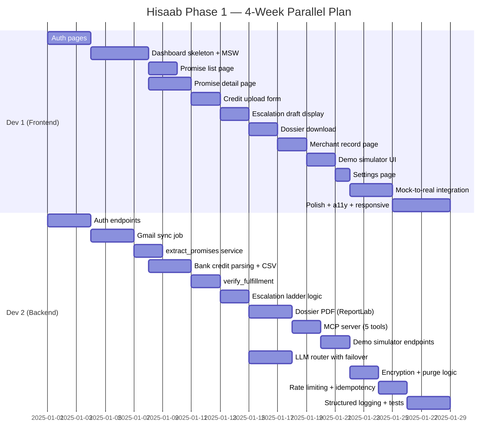

# Hisaab — Execution Guide

> This document is the operational playbook for two developers building the Hisaab monorepo simultaneously. It covers Day 0 setup, the week-by-week parallel work plan, mock-to-real integration steps, Git workflow, and the full test plan.

---

## Who Starts Where

### Dev 1 — Frontend (Day 0 Checklist)

| # | Task | Command / Notes |
|---|------|-----------------|
| 1 | Scaffold Vite project | `pnpm create vite frontend --template react-ts` inside `/frontend` |
| 2 | Install all deps | `pnpm add react-router-dom @tanstack/react-query react-hook-form zod axios` <br> `pnpm add -D tailwindcss postcss autoprefixer msw openapi-typescript vitest @testing-library/react @testing-library/user-event @playwright/test` |
| 3 | Configure Tailwind | `npx tailwindcss init -p` → update `tailwind.config.ts` with `content` glob |
| 4 | Set up React Router | Create `src/router.tsx` with all route definitions (see Frontend Checklist) |
| 5 | Set up TanStack Query | Wrap `<App>` with `<QueryClientProvider>` in `src/main.tsx` |
| 6 | Set up MSW | `npx msw init public/ --save` → create `src/mocks/handlers.ts` with stubs for **all** 25+ endpoints → `src/mocks/browser.ts` |
| 7 | Generate TS types | `npx openapi-typescript ../contracts/openapi.yaml -o src/types/api.ts` (re-run after every contract change) |
| 8 | Scaffold all pages | Create empty page files: `Login`, `AuthCallback`, `Dashboard`, `PromiseDetail`, `Credits`, `MerchantRecord`, `Settings`, `DemoSimulator` |
| 9 | Implement auth pages | `/login` with Google OAuth button + Demo Mode button; `/auth/callback` handler that stores session and redirects to `/` |
| 10 | Add route guards | `<RequireAuth>` wrapper component; unauthenticated users → `/login` |

### Dev 2 — Backend (Day 0 Checklist)

| # | Task | Command / Notes |
|---|------|-----------------|
| 1 | Scaffold FastAPI project | Create `backend/` with `pyproject.toml` (Python 3.12, FastAPI, Uvicorn, Pydantic v2, SQLAlchemy 2, Alembic, ReportLab, cryptography, httpx, FastMCP) |
| 2 | Install deps | `pip install -e ".[dev]"` (editable install with dev extras: pytest, httpx, pytest-asyncio) |
| 3 | Project structure | `backend/app/` → `api/`, `services/`, `models/`, `schemas/`, `llm/`, `mcp/`, `jobs/`, `core/` |
| 4 | Configure settings | `app/core/config.py` using Pydantic `BaseSettings`; `.env.example` committed, `.env` gitignored |
| 5 | Set up Alembic | `alembic init alembic` → configure `env.py` to import all SQLAlchemy models → `alembic revision --autogenerate -m "initial"` |
| 6 | Create all DB models | `User`, `OAuthToken`, `EmailMessage`, `Promise`, `BankCredit`, `EscalationEvent`, `Dossier`, `Job`, `LlmCache` in `app/models/` |
| 7 | Implement auth endpoints | `POST /auth/google/start`, `GET /auth/google/callback`, `POST /auth/demo`, `POST /auth/logout`, `GET /auth/me` |
| 8 | Write health check | `GET /health` → `{"status": "ok", "version": "..."}` |
| 9 | Add middleware | Structured JSON logging middleware + request-ID injection middleware |
| 10 | Run first migration | `alembic upgrade head` against local dev SQLite / Postgres |

---

## Parallel Work Plan — Phase 1 MVP



### Week-by-Week Detail

#### Week 1

| Dev 1 (Frontend) | Dev 2 (Backend) |
|------------------|-----------------|
| Auth pages (`/login`, `/auth/callback`) with Google + Demo buttons | Auth endpoints: `/auth/google/start`, `/auth/google/callback`, `/auth/demo`, `/auth/logout`, `/auth/me` |
| Dashboard skeleton with MSW mock for `/dashboard/summary` and `/promises` | Gmail connect/disconnect endpoints; background Gmail sync job (paginated, 90 days, idempotent) |
| Promise list page with status/category filters and cursor pagination | `extract_promises` service: LLM router chain, prompt injection detection, validation (substring, amount, date) |

#### Week 2

| Dev 1 (Frontend) | Dev 2 (Backend) |
|------------------|-----------------|
| Promise detail page: header, timeline, escalation section | Bank credit email alert parser; CSV upload endpoint with column validation |
| Credit upload form (react-hook-form + zod, CSV file input) | `verify_fulfillment`: amount tolerance, fuzzy merchant matching, date window, ambiguous-match detection |
| Escalation draft display (next step + generated draft text) | Escalation ladder: deterministic rung + deadline math, LLM draft generation with not-legal-advice notice |

#### Week 3

| Dev 1 (Frontend) | Dev 2 (Backend) |
|------------------|-----------------|
| Dossier download button + polling for background job status | Dossier PDF builder with ReportLab (promise history, escalation log, credits, merchant record) |
| Merchant record page (stats display) | FastMCP server mounted at `/mcp`: 5 tools (`extract_promises`, `verify_fulfillment`, `next_escalation_step`, `build_dossier`, `check_merchant_record`) |
| Demo simulator UI (4 scenario buttons + result display) | Demo simulator endpoints; `/simulate` with all 4 scenarios + seed data |
| Settings page (Gmail disconnect, delete account) | LLM router with provider failover + cooldown; LLM response cache (`llm_cache` table) |

#### Week 4

| Dev 1 (Frontend) | Dev 2 (Backend) |
|------------------|-----------------|
| Mock-to-real integration: swap each MSW handler for real API calls group by group | AES-256-GCM token encryption; user delete + data purge cascade |
| Polish: loading skeletons, error boundaries, toast notifications | Idempotency keys middleware; rate limiting |
| Edge cases: network errors, empty states, optimistic updates | Structured logging (JSON, request-ID, latency); integration test suite |
| Responsive design pass + accessibility (keyboard nav, ARIA) | Error handler for all defined error codes |

---

## Mock-to-Real Integration Steps

> **Rule:** Each MSW handler is removed only when the corresponding backend endpoint passes its integration test and is deployed to the shared dev environment. Swap one group at a time and run the corresponding E2E smoke test before moving to the next.

### Group 1 — Auth (switch during Week 4, Day 1)

| MSW Handler | Real Endpoint | Integration Test |
|---|---|---|
| `GET /auth/me` mock | `GET /auth/me` (FastAPI) | `pytest tests/integration/test_auth.py::test_me` |
| `POST /auth/demo` mock | `POST /auth/demo` | `pytest tests/integration/test_auth.py::test_demo_login` |
| `POST /auth/logout` mock | `POST /auth/logout` | `pytest tests/integration/test_auth.py::test_logout` |

Remove: comment out auth handlers in `src/mocks/handlers.ts`, confirm `/login` → `/` flow end-to-end.

### Group 2 — Dashboard + Promises (Week 4, Day 1–2)

| MSW Handler | Real Endpoint | Integration Test |
|---|---|---|
| `GET /dashboard/summary` | `GET /dashboard/summary` | `test_dashboard.py::test_summary` |
| `GET /promises` | `GET /promises` | `test_promises.py::test_list_pagination` |
| `GET /promises/{id}` | `GET /promises/{id}` | `test_promises.py::test_detail` |
| `POST /promises/{id}/dismiss` | `POST /promises/{id}/dismiss` | `test_promises.py::test_dismiss` |

### Group 3 — Gmail Sync (Week 4, Day 2)

| MSW Handler | Real Endpoint | Integration Test |
|---|---|---|
| `GET /gmail/status` | `GET /gmail/status` | `test_gmail.py::test_status` |
| `POST /gmail/sync` | `POST /gmail/sync` (triggers background job) | `test_gmail.py::test_sync_job` |
| `GET /jobs/{id}` | `GET /jobs/{id}` | `test_jobs.py::test_status` |

### Group 4 — Credits (Week 4, Day 2)

| MSW Handler | Real Endpoint | Integration Test |
|---|---|---|
| `POST /credits/upload` | `POST /credits/upload` | `test_credits.py::test_csv_upload` |
| `GET /credits` | `GET /credits` | `test_credits.py::test_list` |

### Group 5 — Escalation (Week 4, Day 3)

| MSW Handler | Real Endpoint | Integration Test |
|---|---|---|
| `GET /promises/{id}/escalation/next-step` | real endpoint | `test_escalation.py::test_next_step` |
| `POST /promises/{id}/escalation/draft` | real endpoint | `test_escalation.py::test_draft_generation` |

### Group 6 — Dossier + Merchant (Week 4, Day 3)

| MSW Handler | Real Endpoint | Integration Test |
|---|---|---|
| `POST /promises/{id}/dossier` | real endpoint (background job) | `test_dossier.py::test_generate` |
| `GET /promises/{id}/dossier` | real download endpoint | `test_dossier.py::test_download` |
| `GET /merchants/{name}` | real endpoint | `test_merchants.py::test_record` |

### Group 7 — Demo Simulator + Settings (Week 4, Day 4)

| MSW Handler | Real Endpoint | Integration Test |
|---|---|---|
| `POST /simulate` | real endpoint | `test_simulator.py::test_all_scenarios` |
| `DELETE /auth/account` | real endpoint | `test_auth.py::test_delete_account` |
| `POST /gmail/disconnect` | real endpoint | `test_gmail.py::test_disconnect` |

---

## Git Workflow

### Branch Naming

```
feature/dev1/<short-description>     # Dev 1 frontend work
feature/dev2/<short-description>     # Dev 2 backend work
fix/dev1/<short-description>
fix/dev2/<short-description>
contract/<short-description>         # openapi.yaml changes — both devs must approve
```

### PR Rules

- All PRs target `develop` (not `main`).
- `main` is release-only; merge from `develop` via a tagged release PR.
- Minimum 1 approval for feature PRs; **2 approvals required** for `contract-change` PRs (both devs must approve).
- Contract change PRs must carry the label **`contract-change`** and must update `contracts/openapi.yaml` **before** any implementation code.
- Do not merge a contract PR until both devs have re-generated their types / updated their mocks.

### Contract Change Protocol

1. Dev who needs the change opens a PR with **only** `contracts/openapi.yaml` changes + updated `docs/API_CONTRACT.md`.
2. Both devs review and approve.
3. After merge: Dev 1 runs `npx openapi-typescript ../contracts/openapi.yaml -o src/types/api.ts` and updates MSW mock. Dev 2 updates Pydantic schemas.
4. Both devs commit their downstream changes in separate PRs referencing the contract PR.

### Commit Message Convention

```
feat(frontend): add promise list page
feat(backend): implement verify_fulfillment
fix(frontend): handle empty dashboard state
fix(backend): correct escalation deadline math
test(backend): add integration tests for /credits
docs: update API_CONTRACT.md for credits endpoint
chore: regenerate TS types from openapi.yaml
```

Format: `<type>(<scope>): <imperative description>`  
Scopes: `frontend`, `backend`, `contracts`, `docs`, `mcp`, `ci`

### Security Rules

- **Never commit `.env` files.** Only `.env.example` with placeholder values is committed.
- Secrets go in environment variables or a secrets manager (never in source).
- `pyproject.toml` and `package.json` lock files (`pnpm-lock.yaml`, `poetry.lock`) are always committed.

---

## Test Plan

### Backend — pytest

#### Unit Tests (`tests/unit/`)

| Module | Test File | Key Cases |
|--------|-----------|-----------|
| `services/extract_promises` | `test_extract_promises.py` | Valid promise extracted; substring check passes/fails; amount not in quote rejected; unparseable date rejected; prompt injection detected |
| `services/verify_fulfillment` | `test_verify_fulfillment.py` | Exact match; amount within 2% tolerance; fuzzy merchant match; date within 7-day window; ambiguous match returns `AMBIGUOUS` not `FULFILLED`; never auto-closes |
| `services/escalation_ladder` | `test_escalation_ladder.py` | Rung 1→2→3 progression; deadline calculation (calendar days); deadline not passed → no advance; LLM draft contains not-legal-advice notice |
| `llm/router` | `test_llm_router.py` | Primary provider success; primary down → fallback; all providers down → raises `LLMUnavailable`; cooldown respected; cache hit returns cached response |

#### Integration Tests (`tests/integration/`)

Use `httpx.AsyncClient` with FastAPI `TestClient` and an in-memory SQLite test DB (or Postgres test container).

| Endpoint Group | Test File | Endpoints Covered |
|---|---|---|
| Auth | `test_auth.py` | `/auth/google/start`, `/auth/google/callback`, `/auth/demo`, `/auth/logout`, `/auth/me`, `DELETE /auth/account` |
| Gmail | `test_gmail.py` | `/gmail/connect`, `/gmail/status`, `/gmail/sync`, `/gmail/disconnect` |
| Jobs | `test_jobs.py` | `GET /jobs/{id}` |
| Promises | `test_promises.py` | `GET /promises`, `GET /promises/{id}`, `POST /promises/{id}/dismiss`, `POST /promises/{id}/re-verify` |
| Credits | `test_credits.py` | `POST /credits/upload`, `GET /credits` |
| Escalation | `test_escalation.py` | `GET /promises/{id}/escalation/next-step`, `POST /promises/{id}/escalation/draft` |
| Dossier | `test_dossier.py` | `POST /promises/{id}/dossier`, `GET /promises/{id}/dossier` |
| Dashboard | `test_dashboard.py` | `GET /dashboard/summary` |
| Merchants | `test_merchants.py` | `GET /merchants/{name}` |
| Simulator | `test_simulator.py` | `POST /simulate` (all 4 scenarios) |
| MCP | `test_mcp.py` | All 5 MCP tools via FastMCP test client |
| Health | `test_health.py` | `GET /health` |

#### Edge Case Tests

| Scenario | Expected Behaviour |
|---|---|
| LLM returns invalid JSON | Router retries once, then raises `LLMParseError`; job marked `FAILED` with error detail |
| All LLM providers down | `503` returned to caller; `Job.status = FAILED`; cooldown set for all providers |
| Gmail OAuth token expired | Sync job catches `401` from Gmail API, sets `OAuthToken.expired = True`, emits structured log |
| CSV upload with wrong columns | `422` with field-level error listing missing/extra columns |
| Prompt injection in email body | `extract_promises` detects and rejects; no LLM call made; event logged |
| Idempotency key reused | Second identical request returns cached response with `X-Idempotent-Replayed: true` header |

### Frontend — Vitest + React Testing Library

#### Unit Tests

| Target | File | Cases |
|--------|------|-------|
| `usePromises` hook | `hooks/usePromises.test.ts` | Fetches list; handles pagination cursor; refetches on filter change |
| `useDashboard` hook | `hooks/useDashboard.test.ts` | Returns summary; handles loading/error states |
| `useEscalation` hook | `hooks/useEscalation.test.ts` | Fetches next step; triggers draft generation; handles optimistic update |
| Utility: `formatAmount` | `utils/currency.test.ts` | Paise → ₹ with correct locale formatting |
| Utility: `formatDate` | `utils/date.test.ts` | UTC → IST display; relative time labels |
| Utility: `parseCsvRow` | `utils/csv.test.ts` | Valid row; missing columns; extra columns |

#### Component Tests

| Component | File | Cases |
|-----------|------|-------|
| `StatusBadge` | `components/StatusBadge.test.tsx` | Renders correct colour/label for each status enum value |
| `AmountDisplay` | `components/AmountDisplay.test.tsx` | Paise converted to ₹; negative amounts; zero |
| `TimelineItem` | `components/TimelineItem.test.tsx` | Renders icon, timestamp, description; IST timezone |
| `PromiseCard` | `components/PromiseCard.test.tsx` | Displays merchant, amount, due date, status; click navigates |
| `EscalationRungBadge` | `components/EscalationRungBadge.test.tsx` | Rung 1/2/3 styling; no rung state |
| `ConfidenceMeter` | `components/ConfidenceMeter.test.tsx` | 0–100 range; correct colour bands |

#### Page Tests

| Page | File | Cases |
|------|------|-------|
| `Dashboard` | `pages/Dashboard.test.tsx` | Empty state (no promises); loaded state (cards + list); error state; loading skeleton |
| `PromiseDetail` | `pages/PromiseDetail.test.tsx` | Full render with MSW mock data; escalation section visible when overdue; dossier button triggers job |
| `Login` | `pages/Login.test.tsx` | Google button present; Demo Mode button present; redirects when already authenticated |
| `Credits` | `pages/Credits.test.tsx` | CSV upload form validates schema; success toast on upload |

### E2E — Playwright (Phase 2)

Full browser test against a running dev stack (backend + frontend + real Gmail sandbox):

```
Login (Google OAuth or Demo Mode)
  → Sync Gmail (trigger sync job, wait for completion)
  → Dashboard (verify promise cards appear)
  → Promise Detail (open first overdue promise)
  → Escalation Draft (generate draft, verify not-legal-advice notice present)
  → Dossier Download (trigger PDF generation, download file, verify non-empty PDF)
```

Additional Phase 2 flows:
- CSV credit upload → verify fulfillment → promise status changes to `FULFILLED`
- Demo simulator → run all 4 scenarios → verify expected outcomes
- Delete account → verify redirect to `/login` → verify data purge (API returns 404)
