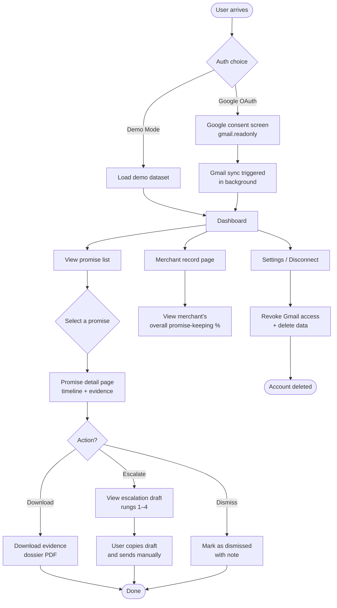
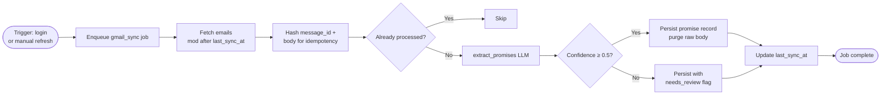
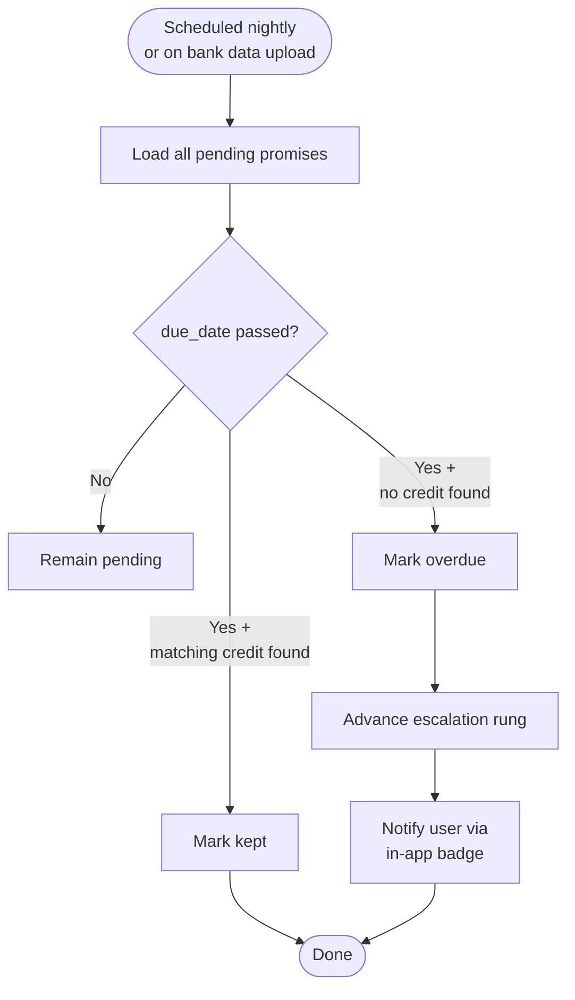

# Hisaab — Project Plan

> **Tagline:** Everyone made you a promise. Hisaab makes sure it is kept.

---

## Table of Contents

1. [Overview](#1-overview)
2. [Objectives](#2-objectives)
3. [Technology Stack](#3-technology-stack)
4. [Team Structure](#4-team-structure)
5. [MVP Scope (Phase 1)](#5-mvp-scope-phase-1)
6. [User Flows](#6-user-flows)
7. [Functional Requirements](#7-functional-requirements)
8. [Non-Functional Requirements](#8-non-functional-requirements)
9. [API Conventions](#9-api-conventions)
10. [LLM Chain](#10-llm-chain)
11. [Phase Roadmap](#11-phase-roadmap)
12. [Priority Table](#12-priority-table)
13. [Glossary](#13-glossary)

---

## 1. Overview

**Hisaab** (Hindi/Urdu for _account_ or _reckoning_) is a web application that acts as a personal promise ledger between individual users and the companies they interact with. Companies routinely make financial promises — refund within 7 business days, insurance claim settled in 30 days, security deposit returned on vacating, delivery by Friday — and users have no systematic way to track, verify, or escalate when those promises are broken.

Hisaab closes this gap by:

- **Ingesting** promise-bearing emails from Gmail (read-only) and parsing them with an LLM chain.
- **Verifying** each promise against independent proof: bank credit alerts and CSV bank statements.
- **Escalating** automatically through a deterministic four-rung ladder when deadlines pass.
- **Producing** an evidence dossier PDF ready to attach to a consumer-forum complaint.

The product is entirely **read + compose** — Hisaab never sends a message on the user's behalf. Every escalation draft is handed back to the user to review and send themselves.

---

## 2. Objectives

| # | Objective | Success Metric |
|---|-----------|---------------|
| O1 | Give users a single pane to see all outstanding financial promises | Dashboard loads < 2 s with 500 promises |
| O2 | Eliminate manual tracking via spreadsheets or memory | ≥ 90 % promise-extraction precision on a 200-email test set |
| O3 | Provide verified proof of promise-breaking before escalation | Fulfillment check is 100 % deterministic (pure code, no LLM) |
| O4 | Reduce friction in consumer escalation | Escalation draft generated in < 10 s end-to-end |
| O5 | Protect user privacy | Raw email bodies purged after extraction; tokens encrypted at rest |
| O6 | Expose capabilities to external agents | MCP server with 5 read-only tools, OpenAPI-contract-first |

---

## 3. Technology Stack

### Monorepo Layout

```
/
├── frontend/        # React app (Dev 1)
├── backend/         # FastAPI service (Dev 2)
├── contracts/       # openapi.yaml (shared)
└── docs/            # Planning & ADRs (shared)
```

### Frontend

| Concern | Library |
|---------|---------|
| Framework | React 18 + TypeScript |
| Build | Vite |
| Routing | React Router v6 |
| Styling | Tailwind CSS |
| Data fetching | TanStack Query v5 |
| Forms | react-hook-form + zod |
| API types | Generated from `contracts/openapi.yaml` |
| Mocking | MSW (Mock Service Worker) |

### Backend

| Concern | Library / Tool |
|---------|---------------|
| Framework | Python 3.12, FastAPI |
| Validation | Pydantic v2 |
| ORM | SQLAlchemy 2 (async) |
| Migrations | Alembic |
| Background jobs | FastAPI BackgroundTasks + `jobs` table |
| MCP server | FastMCP, mounted at `/mcp` |
| PDF generation | ReportLab |
| Auth | Google OAuth (`gmail.readonly` scope) |

### Database

| Environment | Engine |
|-------------|--------|
| Development / Demo | SQLite |
| Production | PostgreSQL |

### Contract-First Workflow

1. API shape agreed in `contracts/openapi.yaml`.
2. Frontend types generated from the contract (`openapi-typescript` or equivalent).
3. MSW handlers generated from the contract for local development without the backend.
4. Backend request/response models validated against the contract in CI.

---

## 4. Team Structure

| Owner | Area | Key Responsibilities |
|-------|------|---------------------|
| **Dev 1** | `/frontend` | React components, routing, TanStack Query hooks, MSW mocks, accessibility, responsive layout |
| **Dev 2** | `/backend` | FastAPI routes, LLM chain, Gmail sync, fulfillment logic, PDF, MCP tools, DB migrations |
| **Both** | `/contracts`, `/docs` | OpenAPI contract, ADRs, this plan |

---

## 5. MVP Scope (Phase 1)

The MVP delivers all 11 features below in a single shippable release. No feature is optional within Phase 1.

| # | Feature | Owner |
|---|---------|-------|
| F01 | Google OAuth login (`gmail.readonly`) + Demo Mode | Both |
| F02 | Gmail sync — read-only, 90-day window, background job, idempotent | Dev 2 |
| F03 | `extract_promises` LLM pipeline | Dev 2 |
| F04 | Bank credit ingestion — email parse + CSV upload | Dev 2 |
| F05 | `verify_fulfillment` — pure-code status engine | Dev 2 |
| F06 | Escalation ladder — 4 rungs, deterministic math + LLM text | Dev 2 |
| F07 | Evidence dossier PDF download | Dev 2 |
| F08 | Dashboard — rupees owed/overdue, promise list, detail timeline | Dev 1 |
| F09 | Merchant promise-keeping record | Dev 1 + Dev 2 |
| F10 | MCP server — 5 read-only tools | Dev 2 |
| F11 | Demo simulator — 4 scripted scenarios | Both |

---

## 6. User Flows

### 6.1 Primary User Journey



### 6.2 New User Flow (Google OAuth)

1. User lands on the marketing / login page.
2. Clicks **"Sign in with Google"**.
3. Completes Google OAuth consent (scope: `gmail.readonly`, `email`, `openid`).
4. Backend exchanges code for tokens, encrypts and stores them.
5. Backend enqueues a `gmail_sync` background job for 90 days of history.
6. User is redirected to the Dashboard, which shows a **"Syncing your inbox…"** banner.
7. TanStack Query polls the job status endpoint every 5 s until `status = completed`.
8. Dashboard populates with extracted promises.

### 6.3 New User Flow (Demo Mode)

1. User clicks **"Try the Demo"** — no sign-in required.
2. Backend loads a seeded dataset of 12 scripted promises across 4 merchants.
3. User can run any of the 4 Demo Simulator scenarios:
   - **Refund Arrives** — a pending refund is marked kept after a matching bank credit appears.
   - **Refund Delayed** — due date passes with no credit; promise flips to overdue; escalation rung 1 unlocks.
   - **Fake Promise Email** — LLM correctly labels confidence < 0.5; human review flag raised.
   - **Duplicate Charge** — bank CSV upload adds a debit that matches a known refund amount.
4. Demo state resets on logout; no data is persisted.

### 6.4 Gmail Sync Job Flow



### 6.5 Fulfillment Verification Flow



---

## 7. Functional Requirements

### 7.1 Authentication (F01)

- **FR-AUTH-01** — Google OAuth 2.0 with scopes `openid`, `email`, `gmail.readonly`.
- **FR-AUTH-02** — OAuth tokens stored encrypted (AES-256-GCM) in the database; never logged.
- **FR-AUTH-03** — Demo Mode: ephemeral session, no token storage, pre-seeded data.
- **FR-AUTH-04** — Token refresh handled automatically; expired tokens surface `GMAIL_AUTH_EXPIRED` error.
- **FR-AUTH-05** — Users can disconnect Gmail and delete all their data via Settings.

### 7.2 Gmail Sync (F02)

- **FR-SYNC-01** — Fetch emails using the Gmail API (`messages.list` + `messages.get`) with a `q` filter limiting to the past 90 days.
- **FR-SYNC-02** — Sync is a background job; frontend polls `GET /api/v1/jobs/{job_id}` until `status = completed | failed`.
- **FR-SYNC-03** — Idempotent: each message is hashed (`sha256(message_id + body_text)`); duplicate hashes are skipped.
- **FR-SYNC-04** — Incremental: `last_sync_at` stored per user; subsequent syncs fetch only messages newer than that timestamp.
- **FR-SYNC-05** — Concurrent sync detection: if a sync job is already running, the endpoint returns `SYNC_IN_PROGRESS`.
- **FR-SYNC-06** — Raw email bodies are purged after extraction; only structured fields are retained.

### 7.3 Promise Extraction (F03)

- **FR-EXT-01** — LLM is invoked with a strict JSON schema; responses not matching the schema are rejected and retried with the next model in the chain.
- **FR-EXT-02** — Output schema (per promise):

  ```json
  {
    "merchant": "string",
    "amount_paise": "integer | null",
    "due_date": "ISO 8601 date | null",
    "exact_quote": "string",
    "confidence": "float 0–1",
    "category": "refund | claim | delivery | deposit | other"
  }
  ```

- **FR-EXT-03** — Code-level validation (Pydantic) rejects any record where `exact_quote` is absent or `confidence` is not in `[0, 1]`.
- **FR-EXT-04** — Promises with `confidence < 0.5` are stored with `status = needs_review` and surfaced to the user for confirmation.
- **FR-EXT-05** — Each promise record stores: `email_message_id`, `email_message_hash`, extracted fields, `created_at`, `status`.

### 7.4 Bank Credit Ingestion (F04)

- **FR-BANK-01** — Email parse: LLM or regex extracts `amount_paise`, `credit_date`, `merchant_hint`, `utr` from bank alert emails in the synced inbox.
- **FR-BANK-02** — CSV upload: accepts standard Indian bank statement CSVs; maps `Credit Amount`, `Date`, `Description` columns; tolerates minor header variations.
- **FR-BANK-03** — Each credit record is idempotent on `(utr | csv_row_hash)`.
- **FR-BANK-04** — Credits are matched to promises by `(merchant, amount_paise ± 1 paise, credit_date ≤ due_date + 3 days)`.

### 7.5 Fulfillment Verification (F05)

- **FR-VER-01** — `verify_fulfillment` is pure Python; zero LLM calls.
- **FR-VER-02** — Status state machine:

  | Current Status | Condition | New Status |
  |---------------|-----------|-----------|
  | `pending` | `credit_date` found, `credit_date ≤ due_date` | `kept` |
  | `pending` | `credit_date` found, `credit_date > due_date` | `kept` (late — noted) |
  | `pending` | `today > due_date`, no credit | `overdue` |
  | `pending` | `confidence < 0.5`, no due_date | `needs_review` |
  | `overdue` | user action | `dismissed` |
  | any | user action | `dismissed` |

- **FR-VER-03** — Verification runs: (a) on every bank data ingestion, (b) nightly for all `pending` promises, (c) on-demand via `POST /api/v1/promises/{id}/verify`.

### 7.6 Escalation Ladder (F06)

Rung selection is deterministic math; only the draft text uses the LLM.

| Rung | Label | Trigger | Draft Type |
|------|-------|---------|-----------|
| 1 | Polite reminder | `overdue` and ≤ 7 days past due | Email to merchant |
| 2 | Firm demand | 8–21 days past due | Email + legal notice reference |
| 3 | Consumer forum | 22–45 days past due | NCDRC complaint draft |
| 4 | Regulatory body | > 45 days past due | RBI / IRDAI / TRAI complaint draft |

- **FR-ESC-01** — Each rung's draft body is generated by the LLM chain; the UI displays it in a read-only textarea.
- **FR-ESC-02** — Every draft includes: **not-legal-advice notice**, user's name, merchant's name, amount in rupees, exact promise quote, chronology of events.
- **FR-ESC-03** — Drafts are user-editable in-browser before copying.
- **FR-ESC-04** — Rung advancement is automatic; user can manually jump rungs.

### 7.7 Evidence Dossier PDF (F07)

- **FR-PDF-01** — Generated server-side by ReportLab; returned as a file download.
- **FR-PDF-02** — Dossier contains: cover page, promise detail, merchant info, chronological timeline of all events (email date → promise extraction → due date → bank data → verification result → escalation steps taken).
- **FR-PDF-03** — `GET /api/v1/promises/{id}/dossier` streams the PDF; `Content-Disposition: attachment`.
- **FR-PDF-04** — Dossier is regenerated on each request (not cached) to include latest events.

### 7.8 Dashboard (F08)

- **FR-DASH-01** — Summary cards: total rupees owed, total rupees overdue, count by status.
- **FR-DASH-02** — Promise list: sortable by due date, amount, merchant, status; filterable by category and status.
- **FR-DASH-03** — Cursor-based pagination (`?cursor=&limit=`).
- **FR-DASH-04** — Promise detail page: full timeline, evidence panel, escalation panel, dossier download button.
- **FR-DASH-05** — Responsive layout; accessible (WCAG 2.1 AA target).

### 7.9 Merchant Record (F09)

- **FR-MERCH-01** — Aggregated view: merchant name, total promises, kept %, average days to fulfillment, overdue count.
- **FR-MERCH-02** — Merchant names normalised (lowercase, strip legal suffixes) for grouping.
- **FR-MERCH-03** — Scoped to the signed-in user's data only (Phase 1); public merchant index is a Phase 3 feature.

### 7.10 MCP Server (F10)

Mounted at `/mcp` via FastMCP. All tools are **read-only**.

| Tool | Input | Output |
|------|-------|--------|
| `extract_promises` | `email_text: str` | `Promise[]` |
| `verify_fulfillment` | `promise_id: UUID` | `VerificationResult` |
| `next_escalation_step` | `promise_id: UUID` | `EscalationStep` |
| `build_dossier` | `promise_id: UUID` | `base64 PDF` |
| `check_merchant_record` | `merchant_name: str` | `MerchantRecord` |

- **FR-MCP-01** — Each tool respects the caller's authenticated session; unauthenticated calls return `AUTH_REQUIRED`.
- **FR-MCP-02** — Tools are documented with descriptions and JSON schemas in the MCP manifest.

### 7.11 Demo Simulator (F11)

- **FR-DEMO-01** — Scenario **Refund Arrives**: inject a matching bank credit; `verify_fulfillment` runs; promise flips to `kept`; dashboard updates.
- **FR-DEMO-02** — Scenario **Refund Delayed**: advance the system clock past `due_date`; promise flips to `overdue`; escalation rung 1 becomes available.
- **FR-DEMO-03** — Scenario **Fake Promise Email**: inject a low-confidence extraction; `needs_review` badge appears; user dismisses it.
- **FR-DEMO-04** — Scenario **Duplicate Charge**: inject a second debit of the same amount; user reconciles via CSV upload.
- **FR-DEMO-05** — Simulator controls are only visible in Demo Mode sessions.

---

## 8. Non-Functional Requirements

### 8.1 Security & Privacy

| Req | Detail |
|-----|--------|
| NFR-SEC-01 | OAuth tokens encrypted at rest (AES-256-GCM); encryption key managed via environment variable / secret manager |
| NFR-SEC-02 | Raw email bodies purged immediately after `extract_promises`; only structured fields + `exact_quote` + `message_hash` are stored |
| NFR-SEC-03 | HTTPS enforced in production; HSTS header |
| NFR-SEC-04 | No PII logged; request IDs used for tracing |
| NFR-SEC-05 | Gmail disconnect flow: revoke token via Google API, delete all user rows across all tables |
| NFR-SEC-06 | CSRF protection on state-changing endpoints |

### 8.2 Performance

| Req | Detail |
|-----|--------|
| NFR-PERF-01 | Dashboard initial load < 2 s (p95) with 500 promises |
| NFR-PERF-02 | Gmail sync: 90 days, ~500 emails processed in < 90 s |
| NFR-PERF-03 | PDF dossier generated in < 5 s |
| NFR-PERF-04 | Escalation draft generated in < 10 s end-to-end |
| NFR-PERF-05 | All list endpoints paginated; max page size 100 |

### 8.3 Reliability & Idempotency

| Req | Detail |
|-----|--------|
| NFR-REL-01 | Gmail sync is idempotent: re-running the same sync produces no duplicate records |
| NFR-REL-02 | Idempotency keys on `POST` endpoints that trigger background jobs |
| NFR-REL-03 | LLM chain degrades gracefully: Groq → gpt-oss-20b → Gemini gemini-3.5-flash-lite → Mistral ministral-8b-latest → deterministic fallback |
| NFR-REL-04 | Background job failures are recorded in the `jobs` table with `status = failed` and an error message |
| NFR-REL-05 | All DB writes in transactions; no partial state on error |

### 8.4 Observability

| Req | Detail |
|-----|--------|
| NFR-OBS-01 | Structured JSON logging (Python `structlog` or equivalent) |
| NFR-OBS-02 | Every HTTP request tagged with a `request_id` (UUID); propagated to background jobs |
| NFR-OBS-03 | LLM calls logged with model used, latency, token counts (no prompt content) |
| NFR-OBS-04 | Job progress events emitted to `jobs` table; frontend polls for status |

### 8.5 Accessibility & Internationalisation

| Req | Detail |
|-----|--------|
| NFR-A11Y-01 | WCAG 2.1 AA compliance target |
| NFR-A11Y-02 | Keyboard navigable; focus rings visible |
| NFR-A11Y-03 | Amounts displayed in Indian rupees (₹) formatted with `Intl.NumberFormat` |
| NFR-A11Y-04 | Phase 2: escalation drafts available in Hindi and Kannada |

---

## 9. API Conventions

| Convention | Value |
|-----------|-------|
| Base path | `/api/v1` |
| Body format | JSON, snake_case keys |
| Response envelope | `{ "data": <payload>, "error": null }` or `{ "data": null, "error": { "code": "...", "message": "..." } }` |
| ID format | UUID strings |
| Money | Integer paise (`amount_paise`); display layer divides by 100 |
| Dates | ISO 8601 (`YYYY-MM-DD` for dates, RFC 3339 for datetimes) |
| Pagination | Cursor-based: `?cursor=<opaque>&limit=<int>` |
| Auth | `Authorization: Bearer <session_token>` header |

### Error Codes

| Code | HTTP Status | Meaning |
|------|-------------|---------|
| `AUTH_REQUIRED` | 401 | No valid session |
| `VALIDATION_ERROR` | 422 | Request body / params failed schema validation |
| `NOT_FOUND` | 404 | Resource does not exist for this user |
| `RATE_LIMITED` | 429 | Too many requests |
| `LLM_UNAVAILABLE` | 503 | All LLM providers exhausted; deterministic fallback active |
| `GMAIL_AUTH_EXPIRED` | 401 | OAuth token expired and refresh failed |
| `SYNC_IN_PROGRESS` | 409 | A Gmail sync job is already running for this user |

---

## 10. LLM Chain

The LLM chain is used for two purposes: `extract_promises` and escalation draft generation. The chain is strictly sequential; each provider is tried only after the previous one fails or returns a schema-invalid response.

```
Groq  gpt-oss-120b
  │  (fail / invalid JSON)
  ▼
Groq  gpt-oss-20b
  │  (fail / invalid JSON)
  ▼
Gemini  gemini-3.5-flash-lite
  │  (fail / invalid JSON)
  ▼
Mistral  ministral-8b-latest
  │  (fail / invalid JSON)
  ▼
Deterministic fallback
  (regex / template; always returns a valid response)
```

- Fallback for `extract_promises`: regex-based heuristics to find amounts, dates, and merchant names; `confidence` capped at `0.4` (triggers `needs_review`).
- Fallback for escalation drafts: a static Markdown template with the user's filled-in fields; LLM-generated prose omitted.
- The model used is recorded on each promise / draft record for auditability.

---

## 11. Phase Roadmap

### Phase 1 — MVP (All 11 Features)

**Goal:** Fully functional promise-tracking app that can be used in production.

| Milestone | Deliverable |
|-----------|-------------|
| M1-1 | Monorepo scaffold, CI skeleton, `contracts/openapi.yaml` v1 draft |
| M1-2 | Auth (Google OAuth + Demo Mode), DB schema v1, Alembic migration |
| M1-3 | Gmail sync job + `extract_promises` LLM chain |
| M1-4 | Bank ingestion (email parse + CSV upload) + `verify_fulfillment` |
| M1-5 | Escalation ladder + PDF dossier |
| M1-6 | Frontend: Dashboard, Promise detail, Merchant record |
| M1-7 | MCP server (5 tools) |
| M1-8 | Demo simulator (4 scenarios) |
| M1-9 | NFR pass: encryption, logging, idempotency, a11y audit |
| M1-10 | Phase 1 release cut |

### Phase 2 — Should Have

**Goal:** Quality-of-life features and broader language support.

| Feature | Description |
|---------|-------------|
| CSV export | Download promise list as CSV for user's own records |
| Dismiss false promises | UI flow to mark a promise as a false positive with a note |
| User-editable escalation drafts | In-browser editing with change history |
| Hindi drafts | Escalation drafts in Hindi |
| Kannada drafts | Escalation drafts in Kannada |

### Phase 3 — Future

**Goal:** Expand data sources, reach, and ecosystem integrations.

| Feature | Description |
|---------|-------------|
| SMS ingestion | Parse bank and merchant SMS messages |
| Live bank APIs | Account Aggregator (AA) framework integration for automatic credits |
| Public merchant index | Anonymised, aggregated merchant promise-keeping scores visible to all users |
| Browser extension | One-click promise capture from any web page or email client |
| WhatsApp | Ingest forwarded screenshots or messages from WhatsApp Business |

---

## 12. Priority Table

| Feature / Requirement | Priority | Phase |
|-----------------------|----------|-------|
| Google OAuth login | **Must** | 1 |
| Demo Mode | **Must** | 1 |
| Gmail sync (90-day, background, idempotent) | **Must** | 1 |
| `extract_promises` LLM chain | **Must** | 1 |
| Bank credit ingestion (email + CSV) | **Must** | 1 |
| `verify_fulfillment` (pure code) | **Must** | 1 |
| Escalation ladder (4 rungs) | **Must** | 1 |
| Evidence dossier PDF | **Must** | 1 |
| Dashboard (summary + list + detail) | **Must** | 1 |
| Merchant promise-keeping record | **Must** | 1 |
| MCP server (5 read-only tools) | **Must** | 1 |
| Demo simulator (4 scenarios) | **Must** | 1 |
| OAuth token encryption at rest | **Must** | 1 |
| Raw email body purge | **Must** | 1 |
| Structured logging + request IDs | **Must** | 1 |
| Idempotent sync + idempotency keys | **Must** | 1 |
| Gmail disconnect + data deletion | **Must** | 1 |
| Responsive + accessible UI | **Must** | 1 |
| Contract-first (openapi.yaml + MSW) | **Must** | 1 |
| CSV export | **Should** | 2 |
| Dismiss false promises (UI flow) | **Should** | 2 |
| User-editable escalation drafts | **Should** | 2 |
| Hindi escalation drafts | **Should** | 2 |
| Kannada escalation drafts | **Should** | 2 |
| SMS ingestion | Future | 3 |
| Live bank APIs (AA framework) | Future | 3 |
| Public merchant index | Future | 3 |
| Browser extension | Future | 3 |
| WhatsApp ingestion | Future | 3 |

---

## 13. Glossary

| Term | Definition |
|------|-----------|
| **Promise** | A commitment by a merchant to perform a financial action (refund, settlement, delivery) by a date |
| **amount_paise** | Money stored as an integer number of paise (1 INR = 100 paise) to avoid floating-point errors |
| **Fulfillment** | A bank credit that matches a promise in merchant, amount, and timing |
| **Verification** | The pure-code process of comparing promises against bank credits to assign a status |
| **Escalation rung** | One of four progressively stronger response steps the user can take against a broken promise |
| **Dossier** | A PDF document compiling all evidence of a promise and its non-fulfillment |
| **Demo Mode** | An authenticated session using pre-seeded data; no real Gmail or bank access required |
| **LLM chain** | The ordered list of LLM providers tried in sequence before the deterministic fallback |
| **MCP** | Model Context Protocol — a standard for exposing tools to external AI agents |
| **message_hash** | `sha256(message_id + body_text)` used to deduplicate Gmail messages |
| **cursor pagination** | A pagination scheme using an opaque cursor token instead of page numbers, safe against concurrent inserts |
| **needs_review** | A promise status meaning the LLM confidence was too low for automatic acceptance |
| **not-legal-advice notice** | A mandatory disclaimer included in all escalation drafts |

---

*Last updated: 2026-11-26 — Phase 1 planning complete.*
